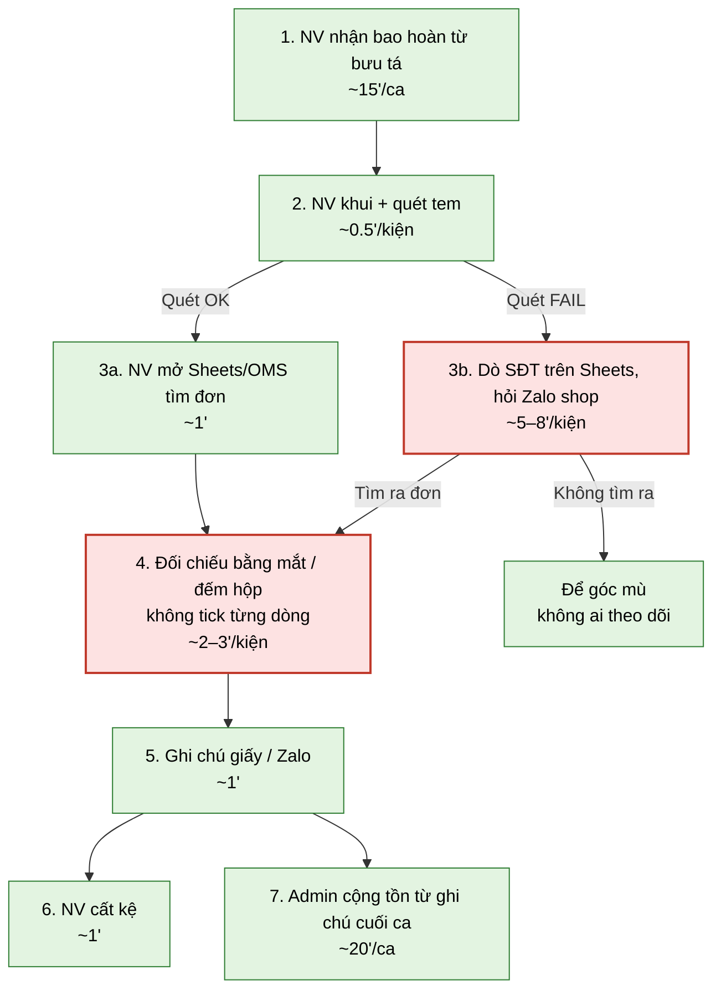
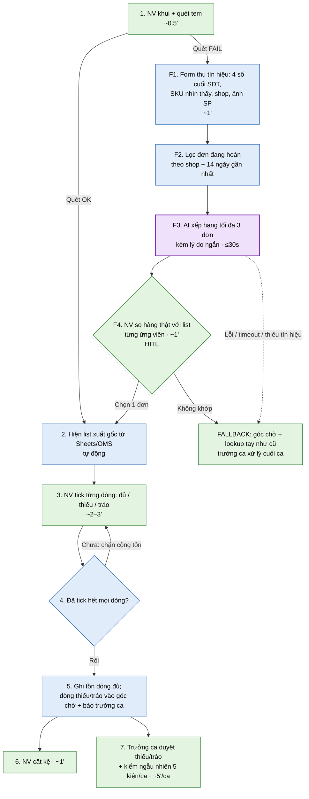

# Báo cáo nhóm — Day 02 Discovery & Problem Framing

> Bản chung của nhóm, viết trên repo do nhóm trưởng fork. Không copy file này sang repo cá nhân.
> Template chi tiết và prompt mẫu: [docs/01-worksheet.md](../../docs/01-worksheet.md). Bài mẫu: [docs/02-deliverable-example.md](../../docs/02-deliverable-example.md).

## 1. Thông tin nhóm

- Tên nhóm: NhomANH
- Thành viên: xem `TEAM.md`
- Candidate problem được chọn (1 câu): Khi khui hoàn (đặc biệt multi-SKU), NV bàn khui kho TMĐT vừa muốn đối chiếu list xuất gốc + tick đủ/thiếu/tráo tại bàn trước khi cộng tồn, để hết restock mù / sót–tráo; nhánh tem fail có AI gợi ý 2–3 đơn + HITL. *(nguồn: `report/individual/idea-chot.md`)*
- Quyết định cuối: **Not Yet** — framing Rule + 1 điểm AI (Workflow); Value/bằng chứng người thật chưa có (lab giả định)

---

## 2. Hội tụ nhóm (CP3)

> Đã chốt theo `idea-chot.md` + hội tụ CP3. Thành viên / phân công: `TEAM.md`.

### 2.1. Pitch

| # | Người đưa ra | Candidate (Job Story ngắn) | Actor | Bottleneck | Câu hỏi phản biện nhận được (ai hỏi) |
|---:|---|---|---|---|---|
| 1 | Lê Thanh Hà (idea-chot) | Khi khui hoàn multi-SKU, muốn tick theo list xuất gốc tại bàn để không cộng tồn mù | NV bàn khui kho vừa | Khui → đối chiếu list → ghi nhận | Kho đã hiện list trên OMS chưa? Data list ở đâu? |
| 2 | Shortlist B (nhóm) | Khi xuất/nhận hoàn, muốn tem phụ + SOP + checklist trên file đã có để giảm hàng mù không cần app mới | NV khui + trưởng ca | Thiếu rule bắt buộc tick / nhận bao | Đã có tem phụ / từ chối bao mù chưa? |
| 3 | Shortlist A — nhánh tem fail | Khi tem fail, muốn định danh đơn rồi mới mở list tick | NV bàn khui | Định danh khi không quét được | % kiện máy quét bó tay? Workaround mất bao lâu? |
| 4 | Loại khỏi shortlist | Bàn giao bao cuối ngày khớp số kiện trước khi ký | NV nhận + trưởng ca | Nhận bao ký mù | *(loại — khó quan sát lab)* |

### 2.2. Cluster

| Cluster | Các candidate | Pattern chung |
|---|---|---|
| A — Hồ sơ đơn tại bàn khui | Tick multi-SKU (E); 1 màn hồ sơ + mất mã (A); Rule/SOP (B) | Thiếu đối chiếu đúng trước restock |
| B — Bằng chứng video | Video ≠ mã (đã loại khỏi chốt) | Thị trường Camsight/Ship Xanh đỏ |
| C — Đầu ca / nhận bao | Bàn giao bao (D) | Pain trước bước khui; phụ thuộc bưu tá |

### 2.3. Opportunity Solution Tree rút gọn

```text
OUTCOME: Giảm restock sai / sót–tráo khi nhập lại hàng hoàn tại bàn khui kho vừa
├── Opportunity: Khui multi-SKU không có (hoặc không dùng) list tick tại bàn
├── Opportunity: Chưa có rule tem phụ / SOP / checklist bắt buộc trước cộng tồn
└── Opportunity (nhánh): Tem fail → không định danh được đơn trước khi xử lý
     ✗ "App AI nhận diện kiện"
     ✗ "WMS full / Pack Station all-in-one"
     ✗ "Tự build camera quay theo mã"   ← đụng Camsight/Ship Xanh
```

Những ý đã gạch bỏ vì là solution đội lốt opportunity:

- App/AI nhận diện ảnh đoán đơn; SaaS “cứu tem rách”; clone Camsight; full WMS.

### 2.4. Chấm điểm shortlist (1–5)

| Candidate | Actor rõ | Quy trình rõ | Pain có bằng chứng | Impact đo được | Vừa sức lab | So sánh được No AI/Rule/Workflow/Agent | Nhóm hiểu domain | Tổng |
|---|---:|---:|---:|---:|---:|---:|---:|---:|
| E — Tick multi-SKU trước restock | 5 | 5 | 2 | 4 | 5 | 5 | 4 | **30** |
| B — Rule/SOP tem phụ + checklist | 5 | 5 | 2 | 3 | 5 | 5 | 4 | **29** |
| A — 1 màn hồ sơ (+ mất mã) | 5 | 5 | 2 | 4 | 4 | 5 | 4 | **29** |

**Candidate được chọn:** E (outcome) + Rule/SOP (B) **luôn bật** + nhánh A gắn **1 điểm AI gợi ý đơn khi tem fail** (Workflow + HITL), bật khi giả định G3 đúng.

**Vì sao chọn:** Outcome hàng ngày (tick list); AI không thay SOP — chỉ hỗ trợ định danh khi quét fail; không Agent, không đua cam.

**Vì sao loại các candidate còn lại:** D khó quan sát cửa nhận; video-theo-mã thị trường đỏ; SaaS chỉ “cứu tem” yếu Viability.

**Xử lý bất đồng (nếu có):** Muốn “nhiều AI hơn” → không: Rule đủ cho tick; AI chỉ 1 chỗ. G3 sai → tắt AI, giữ Rule.

---

## 3. Kiểm chứng + research giải pháp đã có (CP4)

### 3.1. Assumption Map

ID **G1–G5** là giả định chết người (khớp `idea-chot.md` và §6–§8). Các dòng không mang mã G vẫn phải hỏi, nhưng không quyết định bật/tắt AI.

| # | ID | Giả định | Loại (Value / Usability / Feasibility / Viability) | Quan trọng (1–5) | Đã có bằng chứng (1–5) | Kiểm chứng trước? |
|---:|---|---|---|---:|---:|---|
| 1 | **G1** | Ở kho target, NV thường **không** soi list từng dòng khi khui multi-SKU (hoặc list không hiện tại bàn) | Value | 5 | 1 | ✅ Ưu tiên phỏng vấn |
| 2 | **G2** | List xuất gốc **đã mở được** trên Sheets/OMS kho đang dùng — không cần build đồng bộ đa sàn ngày 1 | Feasibility | 5 | 2 | ✅ Hỏi “data nằm đâu” |
| 3 | — | Sót/tráo hoặc phút dư đối chiếu đủ đau để trưởng ca chịu **thử SOP/checklist 1–2 ca** | Value | 4 | 1 | ✅ Hỏi chuyện đã xảy ra + cam kết thử |
| 4 | — | NV sẽ tuân thủ tick trước cộng tồn nếu có rule + 1 màn cố định (không bỏ về thói quen đếm hộp) | Usability | 4 | 1 | Sau khi có SOP thử |
| 5 | — | Kho target **chưa** có WMS/return-check kiểu GoWarehouse (scan → load list → scan từng món) | Feasibility | 4 | 2 | ✅ Hỏi tool đang dùng |
| 6 | **G3** | Tem fail + lookup tay vẫn tắc (nhiều phút / dễ sai đơn) **sau khi** đã lọc theo shop + 4 số cuối SĐT + 14 ngày. Chỉ khi tập còn >3 đơn thì AI top-3 mới có ích hơn Rule thuần | Value (điều kiện bật AI) | 5 | 1 | ✅ Khai báo giả định; chưa có interview |
| 7 | **G4** | Input AI có sẵn và an toàn (4 số cuối SĐT, SKU, shop, ± ảnh SP nếu kho cho phép); không gửi SĐT đầy đủ / tên khách | Feasibility / Viability | 4 | 2 | Framing bảo mật; hỏi kho có cho dùng ảnh không |
| 8 | **G5** | Chọn nhầm đơn (báo nhầm) tệ hơn không gợi ý được (bỏ sót) → AI chỉ suggest, không auto-chốt | Usability / boundary | 5 | 1 | Chưa hỏi NV. Đây là lựa chọn thiết kế (§6.4), chưa phải hành vi đã quan sát |

Giả định nhóm ưu tiên (không có người kho trong lab → **giữ bằng chứng = 1**, không bịa snapshot): **G1, G2, G3**. Câu hỏi Mom Test (chưa dùng): [`report/assets/cp4-interview-guide.md`](../assets/cp4-interview-guide.md).

### 3.2. Kiểm chứng

Cách đã dùng: **Research desktop (mở lại link 2026-11-09)** + **khung phỏng vấn Mom Test đã soạn** — *chưa có Interview Snapshot người thật (0 người, không bịa)*.

Câu hỏi đã soạn, toàn bộ hỏi hành vi đã xảy ra (nguyên văn trong [`cp4-interview-guide.md`](../assets/cp4-interview-guide.md)):

1. Lần gần nhất khui hoàn, từ nhận bao đến cộng tồn đã làm những bước nào?
2. Đơn nhiều món trong ca đó có mở list xuất gốc không, hay đối chiếu bằng mắt?
3. List đang nằm ở đâu, và ai mở được ngay tại bàn?
4. Lần gần nhất thiếu / tráo / lệch tồn vì hàng hoàn — chuyện gì đã xảy ra?
5. Lần gần nhất tem quét fail — làm gì tiếp, mất bao lâu, kiện đi đâu?
6. Khi đã có shop và vài số điện thoại, còn phải dò bao nhiêu đơn?
7. Đang dùng phần mềm nào lúc khui?
8. Nếu tuần này in checklist tick-trước-cộng-tồn, cho xem hoặc cho quan sát 1 ca được không?

Không có câu nào dạng “bạn có muốn dùng AI không”.

Interview snapshot — template trống (copy khi hỏi xong; file [`cp4-interview-snapshot-1.md`](../assets/cp4-interview-snapshot-1.md) cũng đang để trống):

| Trường | Nội dung |
|---|---|
| Người được hỏi (vai trò, không ghi tên thật) | *(điền sau phỏng vấn)* |
| Câu nói đáng nhớ nhất (nguyên văn) | |
| Lần gần nhất gặp vấn đề này: chuyện gì đã xảy ra? | |
| Hiện đang xử lý bằng cách nào (workaround)? | |
| Mất bao lâu, bao lần? | |
| Insight / opportunity rút ra | |

Tổng hợp:

| Nguồn | Số người / số mẫu | Tín hiệu xác nhận | Tín hiệu phản bác |
|---|---:|---|---|
| Phỏng vấn kho / NV khui | **0** (đang mở) | — | — |
| Research tool (Camsight, Ship Xanh, GoWarehouse, ChannelDock, ResReturn) | 5 nguồn, HTTP 200 ngày 2026-11-09; đọc lại toàn văn ChannelDock và ResReturn | Pattern “scan → thấy expected SKU → check / grade trước restock” là best practice WMS; VN mạnh ở **video theo mã** | Tool sẵn **giả định quét được mã** hoặc cần WMS; không chứng minh kho Sheets VN thiếu tick. Số NRF 19,3% (ChannelDock, thị trường Mỹ) **không** dùng cho G1/G3 |
| Phản biện thị trường (Gemini — chỉ giữ ý, bỏ số %) | 1 vòng | Micro-tool mất tem khó thu tiền; integration trap | Phân bổ % kho / WTP số cụ thể = chưa xác minh → **không dùng làm bằng chứng** |

**Tín hiệu phản bác (desktop, ghi sớm):** Nếu kho đã Camsight/Ship Xanh + gõ SĐT trên Pancake/Sapo ra list trong &lt;1–2 phút và đã tick/đối chiếu → **G1–G2 yếu** → đổi/thu hẹp. Nếu tem fail nhưng lọc theo shop + 4 số + 14 ngày đã ra ≤3 đơn ở phần lớn ca → **G3 yếu** → tắt AI, giữ Rule (§6.2).

**Nhóm đã sửa problem thế nào sau kiểm chứng:**

- Trước research: dễ lệch sang “cứu kiện mất mã”, “camera theo mã”, hoặc “app AI kho”.
- Sau research desktop: **core = Rule tick list trước restock**. Video-theo-mã và WMS return-check không phải khoảng trống của lab. AI không thay bước tick.
- Sau khi so 4 mức (§6.2) và ngưỡng dừng (§8): Rule lọc trước (shop + 4 số cuối SĐT + đơn đang hoàn 14 ngày). AI xếp hạng tối đa 3 đơn **chỉ khi** tập lọc còn >3 ứng viên. Nếu ≥80% ca tem fail đã ≤3 ứng viên → tắt AI, hạ xuống Rule. G5 buộc HITL kể cả khi chỉ còn 1 ứng viên: AI không tự chọn đơn.
- Lab không có phỏng vấn kho: G1 và G3 (Value) vẫn bằng chứng = 1 → **Not Yet**. Không lấy tỉ lệ hoàn hàng Mỹ làm bằng chứng cho kho Việt Nam.

### 3.3. Research giải pháp đã có

> Mở lại ngày 2026-11-09. Biên bản: [`report/assets/cp4-research-link-check.md`](../assets/cp4-research-link-check.md). Không có file `COMPETITOR_RESEARCH.md` — bảng này là nguồn research của nhóm.

| Công cụ / case / pattern | Link | Giải bước nào trong quy trình? | Điểm mạnh | Khoảng trống / rủi ro | Bài học cho nhóm |
|---|---|---|---|---|---|
| **Camsight — quét đơn hoàn** | https://camzone.vn/camsight-cap-nhat-tinh-nang-quet-don-hoan-cach-thuc-hien-va-quan-ly-du-lieu | Khui hoàn: quét mã → ghi video theo đơn `[HOÀN]-mã`; đối chiếu video đi/về; xuất Excel danh sách hoàn | Đúng pain bằng chứng khiếu nại VN; thao tác quen shop | **Phụ thuộc đưa được mã vào khung**; không phải màn tick đủ/thiếu từng SKU trước cộng tồn | **Không build cam.** Dùng tool sẵn nếu kho cần video; outcome mình khác = list tick |
| **Ship Xanh — quay đóng/khui** | https://shipxanh.com/tdcpt_case_studies/quay-video-dong-goi-khui-hang/ | Detect QR/mã → tự cắt clip đóng/khui; proof trên video | Có trong suite bán hàng; hỗ trợ webcam/RTSP/ĐT | Tập trung bằng chứng video + trạng thái đơn; không thay bước đối chiếu list món | Thị trường video đỏ → loại khỏi candidate chính |
| **GoWarehouse Return Check** | https://docs.gowarehouse.ai/en/operator/return_orders/verification | Scan return/fulfillment/tracking → **load list SP expected** → scan từng món → confirm check → mới inbound; có thể kèm video | **Gần outcome E nhất**: list + check từng dòng trước restock | Cần hệ thống return/fulfillment sẵn (WMS); kho Sheets khó nhảy vào | Pattern đúng = Workflow WMS. Lab nhái **hành vi** bằng Sheets/OMS nhẹ, không clone WMS |
| **ChannelDock — WMS returns** | https://channeldock.com/en/blogs/ecommerce-wms-returns-processing/ | Scan RMA → match order/SKU → grade → quarantine → restock chỉ khi trusted | Nhấn mạnh: **không cộng tồn chỉ vì kiện đã về**; KPI return-to-resale | Enterprise/WMS mindset; không phải micro-tool VN | Xác nhận core value nhóm: đối chiếu trước restock là chuẩn ops, không phải “ý hay AI” |
| **ResReturn — receiving workflow** | https://resreturn.com/blog/returns-receiving-workflow | Intake → unpack/identify → inspect/grade → disposition + post hệ thống | Unreadable/mismatch = exception path; metric dock rõ | Blog quy trình, không phải sản phẩm nhẹ cho kho Sheets VN | Nhánh mất mã/tem = exception, không phải toàn bộ product |

**Kết luận research (1 đoạn):**

```text
Thế giới đã giải mạnh: (1) video theo mã khi scan được — Camsight/Ship Xanh;
(2) list + scan/grade trước restock — WMS (GoWarehouse, ChannelDock, ResReturn).
Khoảng trống lab vẫn chỉ là giả định: kho Sheets/OMS nhẹ chưa có bước tick bắt buộc.
AI không lấp khoảng trống đó. AI chỉ còn vai trò khi tem fail và Rule lọc
(shop + 4 số + 14 ngày) vẫn để lại hơn 3 đơn (G3). Không build cam / Agent.
Chưa có hành vi người kho → Not Yet.
```

---

## 4. Quy trình trước/sau (CP5)

> Mọi số phút trong mục này là **ước lượng của nhóm, chưa đo** (chưa quan sát kho thật, xem §3.2). Cách đo thật ghi ở Success Metric §5.
> Bản Mermaid riêng: [`report/assets/cp5-quy-trinh-mermaid.md`](../assets/cp5-quy-trinh-mermaid.md).
> Chú thích màu: 🟦 Rule/script · 🟪 AI · 🟩 Con người (HITL) · 🟥 Bottleneck

### 4.1. Quy trình hiện tại



```text
HIỆN TẠI — 1 kiện multi-SKU (ước lượng, chưa đo)

Tem OK  : [Khui+quét 0.5'] → [Mở Sheets tìm đơn 1'] → [Đối chiếu bằng mắt 2–3'] ← BOTTLENECK
          → [Ghi chú 1'] → [Cất kệ 1']                                ≈ 6'/kiện
Tem FAIL: [Khui+quét 0.5'] → [Dò SĐT/Zalo 5–8'] ← BOTTLENECK nhánh → [Đối chiếu 2–3']
          → [Ghi chú 1'] → [Cất kệ 1']                                ≈ 11'/kiện (hoặc vào góc mù)
Cuối ca : [Admin cộng tồn từ ghi chú ~20'/ca]
```

| Bước | Actor | Input | Output | Thời gian / tần suất (ước lượng) | Handoff |
|---:|---|---|---|---|---|
| 1 | NV nhận | Bao hoàn từ bưu tá | Kiện lên bàn khui | ~15'/ca, 1–2 lần/ngày | → NV khui |
| 2 | NV khui | Kiện + tem vận đơn | Mã đơn (OK) hoặc không có mã (FAIL) | ~0.5'/kiện, 50–300 kiện/ngày | — |
| 3a | NV khui | Mã đơn | Đơn trên Sheets/OMS | ~1'/kiện | — |
| 3b | NV khui | SĐT / tên còn đọc được, hỏi shop qua Zalo | Đơn đoán được hoặc không | **~5–8'/kiện**, giả định 5–10% kiện | → shop (Zalo) nếu không tự tìm ra |
| 4 | NV khui | Hàng thật + list đơn (nếu có mở) | Kết luận "đủ/thiếu" trong đầu, không có bản ghi từng dòng | **~2–3'/kiện multi-SKU** | — |
| 5 | NV khui | Kết luận bước 4 | Ghi chú giấy / tin Zalo | ~1'/kiện | → Admin |
| 6 | NV khui | Hàng đã khui | Hàng trên kệ | ~1'/kiện | — |
| 7 | Admin | Ghi chú cả ca | Tồn kho cập nhật | ~20'/ca | — |

**Bottleneck chính:** Bước 4. Không có list tick từng dòng nên NV đối chiếu bằng mắt, không để lại bản ghi, dễ sót hoặc nhận tráo rồi vẫn cộng tồn.
**Bottleneck nhánh:** Bước 3b. Tem fail thì phải dò đơn 5–8' mới đối chiếu được, hoặc kiện bị bỏ vào góc mù.

### 4.2. Quy trình tương lai



| Bước | Ai / cái gì làm | Loại | Ghi chú |
|---:|---|---|---|
| 1 | NV khui | Con người | Như cũ |
| 2 | Sheets/OMS hiện list theo mã đơn | **Rule** | Không cần AI: tra theo mã là đúng/sai rõ |
| 3 | NV tick đủ / thiếu / tráo từng dòng | **Con người** | Thay cho "đối chiếu bằng mắt + ghi chú" |
| 4 | Chặn cộng tồn khi còn dòng chưa tick | **Rule** | if/else trên checklist |
| 5 | Ghi tồn dòng "đủ"; dòng thiếu/tráo → góc chờ + báo trưởng ca | **Rule** | Bỏ bước admin nhập tay cuối ca |
| 6 | NV cất kệ | Con người | Như cũ |
| 7 | Trưởng ca duyệt thiếu/tráo + kiểm ngẫu nhiên 5 kiện/ca | **Con người (HITL)** | Chống "tick cho có" |
| F1–F2 | Form thu tín hiệu + lọc đơn đang hoàn theo shop, 14 ngày | **Rule** | Thu hẹp tập ứng viên trước khi gọi AI |
| F3 | Xếp hạng tối đa 3 đơn kèm lý do | **AI** | Điểm AI duy nhất trong quy trình |
| F4 | NV so hàng thật với list từng ứng viên, chọn 1 hoặc "không khớp" | **Con người (HITL)** | Bắt buộc, kể cả khi chỉ có 1 ứng viên |

**Boundary:** AI không tự chọn đơn, không sửa tồn, không gửi khiếu nại sàn/khách, không nhận SĐT đầy đủ hay tên khách (chỉ 4 số cuối + SKU + shop + ảnh SP).

**Khi nào con người kiểm tra (HITL):** (1) mọi kiện tem fail, NV chọn đơn ở F4; (2) mọi kiện, NV tick ở bước 3; (3) mọi dòng thiếu/tráo, trưởng ca duyệt ở bước 7; (4) trưởng ca kiểm ngẫu nhiên 5 kiện/ca.

**Phương án quay về:**

- AI lỗi, timeout >30s, trả "không đủ tín hiệu" hoặc NV bấm "không khớp" → góc chờ + lookup tay như quy trình hiện tại; trưởng ca xử lý cuối ca.
- Sheets/OMS không mở được list → ghi phiếu giấy, **không cộng tồn** đến khi nhập lại và tick.
- Pilot cho thấy AI không giúp (xem ngưỡng §8) → tắt nhánh F3, giữ F1–F2 Rule lọc + lookup tay.

### 4.3. Before / after

| Chỉ số | Trước (ước lượng) | Sau (kỳ vọng) | Ghi chú |
|---|---:|---:|---|
| Thời gian/kiện multi-SKU, tem OK | ~6' | ~4–6' | Tick thay "đối chiếu bằng mắt + ghi chú". **Không được chậm hơn trước** (guardrail) |
| Thời gian/kiện, tem fail | ~11' hoặc vào góc mù | ~6–7' nếu AI gợi ý trúng; ~11' khi fallback | Chỉ 5–10% kiện (giả định G3) |
| Admin cộng tồn cuối ca | ~20'/ca | ~0' (Rule ghi tồn) + trưởng ca duyệt ~5'/ca | |
| Kiện có bản ghi tick từng dòng | ~0% (hiện không có checklist, giả định G1) | ≥90% | Metric chính |
| Số bước thủ công (nhánh OK) | 6/6 | 3/5 (khui, tick, cất kệ) | Rule làm hiện list, chặn, ghi tồn |
| Bottleneck chính | Đối chiếu bằng mắt; dò đơn khi tem fail | NV tick từng dòng | Bottleneck chấp nhận được vì đây là điểm kiểm soát chất lượng |
| Rủi ro mới phát sinh | — | (1) AI gợi ý sai → chọn nhầm đơn; (2) NV "tick cho có" | (1) HITL bắt buộc + eval §7; (2) trưởng ca kiểm ngẫu nhiên |

---

## 5. Problem Statement v0 (CP5)

| Trường | Nội dung |
|---|---|
| **Actor** | NV bàn khui hàng hoàn ở kho fulfillment / shop tự kho TMĐT quy mô vừa (~50–300 kiện hoàn/ngày, *giả định*), quản lý đơn trên Sheets hoặc OMS nhẹ, chưa có WMS |
| **Quy trình** | Nhận bao → khui + quét tem → (OK) mở Sheets/OMS tìm đơn / (FAIL) dò SĐT, hỏi Zalo → đối chiếu bằng mắt → ghi chú → cất kệ → admin cộng tồn cuối ca |
| **Bottleneck** | Bước đối chiếu hàng với list xuất gốc: không có checklist từng dòng nên làm bằng mắt (~2–3'/kiện multi-SKU), không để lại bản ghi, dễ sót/tráo. Nặng hơn khi tem fail vì phải dò đơn ~5–8' mới đối chiếu được |
| **Impact** | Hàng thiếu/tráo vẫn được cộng tồn; kiện tem fail nằm góc mù; lệch tồn chỉ lộ khi kiểm kê; admin mất ~20'/ca nhập lại ghi chú *(ước lượng, chưa đo)* |
| **Success Metric** | Xem bảng ngay dưới |
| **Boundary** (không được làm gì; khi nào cần HITL) | Không cộng tồn kiện chưa được người tick đủ mọi dòng. Quyết định "kiện này của đơn nào" và "đủ/thiếu/tráo" luôn do NV đưa ra; mọi dòng thiếu/tráo phải qua trưởng ca duyệt. Mọi công cụ hỗ trợ không được tự chốt đơn, tự sửa tồn, tự gửi khiếu nại |

**Success Metric v0:**

| # | Metric | Baseline | Target | Cách đo |
|---:|---|---|---|---|
| M1 | % kiện multi-SKU có tick đủ mọi dòng trước khi cộng tồn | ≈0% *(giả định G1: hiện không có checklist)*. Xác nhận bằng quan sát 1 ca trước pilot | ≥90% | Đếm số kiện có log tick / tổng kiện được cộng tồn, 2 tuần pilot |
| M2 | Thời gian xử lý/kiện multi-SKU (quét → cất kệ) | ~6' tem OK, ~11' tem fail *(ước lượng)* | Tem OK: không tăng; tem fail: ≤6' | Bấm giờ 20 kiện/ca × 2 ca trước pilot và 2 ca cuối pilot |
| M3 | Số dòng SKU hàng hoàn lệch khi kiểm kê tuần | Chưa đo: lấy từ biên bản kiểm kê 4 tuần gần nhất | Giảm ≥50% | So biên bản kiểm kê 4 tuần trước với 4 tuần pilot |

Phản biện nhận được (từ AI và trong nhóm) và nhóm có đồng ý không:

- "Không phỏng vấn thì Value yếu" → **Đồng ý.** Giữ Not Yet, không bịa snapshot; baseline ghi rõ "ước lượng / giả định".
- "Bắt tick từng dòng có thể làm NV chậm hơn" → **Đồng ý.** Đặt M2 nhánh tem OK làm **guardrail** (không được tăng), còn M1 và M3 là metric chính.
- "v0 chỉ đo tốc độ và tỉ lệ tick, chưa đo NV có tick đúng hay không" → **Đồng ý một phần.** M3 (lệch kiểm kê) gián tiếp đo độ đúng; thêm kiểm ngẫu nhiên 5 kiện/ca vào quy trình tương lai.
- "Chỉ Rule thì không có AI" → **Đồng ý một phần.** Mức can thiệp chưa chốt ở v0; CP6 xét thêm 1 điểm AI có điều kiện G3.

---

## 6. Mức can thiệp AI (CP6)

### 6.1. Ma trận độ mơ hồ × độ phức tạp

| Phần việc | Độ mơ hồ | Độ phức tạp | Ô ma trận → mức |
|---|---|---|---|
| Hiện list theo mã đơn, chặn cộng tồn, ghi tồn | **Thấp**: tra mã có đúng/sai rõ | **Thấp**: 1 nguồn, các bước cố định | Rule |
| Định danh đơn khi tem fail | **Cao**: tín hiệu thiếu, mờ, nhiều đơn gần giống (cùng shop, cùng SKU, SĐT chỉ còn vài số) | **Thấp–TB**: 1 bước trong luồng cố định, không rẽ nhánh tự do | Workflow có AI ở 1 bước |

Vì sao: phần lớn quy trình có đúng/sai rõ nên Rule là đủ. Chỉ đoạn "từ tín hiệu không đầy đủ → đơn nào" là mơ hồ, và đoạn đó nằm gọn trong một bước, nên không cần AI tự lập kế hoạch.

### 6.2. So sánh 4 mức

| Mức | Phương án cho bài của nhóm | Đủ khi nào | Rủi ro | Chọn? |
|---|---|---|---|---|
| **No AI** | SOP "soi list trước khi cộng tồn" + in list giấy + nhắc miệng | NV đã có thói quen tick | Không ép được hành vi; không có bản ghi để đo | Không đủ một mình |
| **Rule** | Sheets/OMS hiện list theo mã; checklist tick bắt buộc; chặn cộng tồn khi chưa tick; khi tem fail, lọc đơn đang hoàn theo shop + 4 số SĐT + 14 ngày | Tem fail ít, **hoặc** Rule lọc đã ra ≤3 ứng viên ở phần lớn ca fail | Không xử lý được tín hiệu chỉ còn ảnh SP / chữ mờ / SĐT thiếu → ra quá nhiều ứng viên | **Luôn bật** (nền) |
| **Workflow** | Rule nền + (chỉ khi tem fail và Rule lọc ra >3 ứng viên) AI xếp hạng top-3 → NV chọn → list tick | G3 đúng: tem fail đủ nhiều và Rule lọc không thu hẹp đủ | Gợi ý sai; phụ thuộc input; chi phí gọi model | **Chọn** (AI chỉ 1 bước) |
| **Agent** | AI tự tìm nguồn, tự chọn đơn, tự cộng tồn, tự gửi khiếu nại | Không có trường hợp nào: bước tiếp theo luôn biết trước | Chọn nhầm đơn = cộng tồn sai, khiếu nại sai, mất tiền | **Không** |

**Mức chọn:** **Workflow** = Rule (nền, luôn bật) + AI xếp hạng ứng viên ở nhánh tem fail.

**Vì sao không chọn mức đơn giản hơn:**

- **No AI** không ép được hành vi tick và không để lại bản ghi, nên không đo được M1.
- **Rule** giải được phần tick và phần lọc khi tín hiệu rõ. Nhưng khi tín hiệu chỉ còn ảnh SP, chữ tay mờ hoặc SĐT thiếu số, Rule lọc sẽ ra hàng chục đơn cùng shop. NV vẫn phải dò tay ~5–8', đúng bottleneck nhánh.
- **Điều kiện để giữ AI:** pilot chạy Rule lọc trước. Nếu Rule lọc đã ra ≤3 ứng viên ở ≥80% ca tem fail → **không cần AI, hạ xuống Rule** (ngưỡng dừng §8).

**Vì sao không chọn Agent:** quy trình cố định, chỉ một chỗ cần "đoán". Cho AI quyền tự chốt đơn hoặc sửa tồn sẽ làm kiểu sai tệ nhất (báo nhầm, §6.4) xảy ra mà không ai chặn.

### 6.3. AI Canvas rút gọn

| Thành phần | Nội dung |
|---|---|
| **Prediction**: AI dự đoán / tạo ra gì? | Xếp hạng tối đa 3 đơn ứng viên cho kiện tem fail, mỗi đơn kèm lý do ngắn (khớp trường nào); hoặc trả "không đủ tín hiệu" |
| **Judgment**: con người cân nhắc, quyết định gì? | NV so hàng thật trong kiện với list SKU của từng ứng viên → chọn 1 đơn hoặc "không khớp". Trưởng ca duyệt kiện "không khớp" và các dòng thiếu/tráo |
| **Action**: hành động cuối cùng là gì, ai làm? | NV mở list của đơn đã chọn → tick từng dòng → Rule ghi tồn dòng "đủ". AI không thực hiện hành động nào |
| **Outcome**: đo kết quả bằng gì? | M2 (phút/kiện tem fail), M4 (% đơn đúng nằm trong top-3), M5 (số lần chọn nhầm đơn sau HITL) |
| **Input**: AI cần dữ liệu gì mỗi lần chạy? Có sẵn không? | (1) Tín hiệu từ kiện: 4 số cuối SĐT, SKU/biến thể nhìn thấy, shop trên bao bì, ảnh SP nếu kho cho phép; (2) danh sách đơn đang hoàn của shop đó trong 14 ngày (mã đơn, 4 số cuối SĐT, SKU + biến thể, ngày giao), lấy bằng Rule F2. *Giả định có sẵn trên Sheets/OMS (G2, G4), chưa xác minh với kho thật* |
| **Feedback**: lấy phản hồi ở đâu để cải thiện? | Log mỗi kiện fail: top-3 AI đưa ra, đơn NV chọn, số lần bấm "không khớp"; đơn thật của kiện "không khớp" sau khi trưởng ca xử lý → bổ sung vào bộ eval |

### 6.4. Hai câu hỏi của Google PAIR

- **Augment hay automate?** → **Augment.** AI chỉ thu hẹp từ hàng chục đơn xuống 2–3 đơn; NV vẫn so hàng thật và chọn. Chưa có bằng chứng người kho muốn giao máy tự chốt đơn (chưa phỏng vấn, G5). Automate có rủi ro tiền cao: cộng tồn sai, khiếu nại sai.
- **AI sai kiểu nào tệ hơn?** → **Báo nhầm tệ hơn bỏ sót.** Đưa đơn sai lên top khiến NV dễ chọn nhầm → cộng tồn sai đơn, khó phát hiện. Bỏ sót (không gợi ý được) chỉ làm NV quay về lookup tay như hiện tại. Thiết kế: không auto-select; thiếu tín hiệu thì trả "không đủ tín hiệu"; eval phạt nặng việc bịa ID và chọn nhầm sau HITL.

---

## 7. Problem Statement v1 + tiêu chí đánh giá (CP6)

| Trường | Nội dung |
|---|---|
| **Actor** | NV bàn khui hàng hoàn ở kho fulfillment / shop tự kho TMĐT vừa, quản lý đơn trên Sheets/OMS nhẹ, **list xuất gốc mở được theo mã đơn** (G2), và **tem fail chiếm đủ nhiều, ≥5% kiện hoàn** (G3, *giả định*) |
| **Quy trình** | Khui + quét → (OK) list tự hiện → tick từng dòng → Rule ghi tồn / (FAIL) form tín hiệu → Rule lọc đơn đang hoàn → AI top-3 → NV chọn → list → tick |
| **Bottleneck** | Như v0: đối chiếu không có checklist; định danh đơn khi tem fail ~5–8' |
| **Impact** | Như v0 *(ước lượng, chưa đo)* |
| **Success Metric** | M1–M3 như v0, thêm M4–M5 (bảng dưới) |
| **Boundary** | Như v0, thêm: AI **không tự chọn đơn kể cả khi chỉ có 1 ứng viên**; không sửa tồn; không gửi khiếu nại; không nhận SĐT đầy đủ / tên khách; thiếu tín hiệu thì phải trả "không đủ tín hiệu" thay vì đoán. HITL bắt buộc ở F4 (chọn đơn), bước 3 (tick), bước 7 (trưởng ca duyệt) |
| **AI intervention point** | Sau khi quét tem FAIL và Rule lọc ra **>3** đơn ứng viên; trước khi NV chọn đơn và mở list tick. Không có AI ở nhánh tem OK |
| **Mức chọn** | Workflow (Rule nền + AI 1 bước) |
| **Rủi ro & người kiểm tra** | (1) AI gợi ý sai → NV chọn nhầm: NV so hàng thật với list từng ứng viên; trưởng ca kiểm ngẫu nhiên 5 kiện/ca. (2) NV tick cho có: trưởng ca kiểm ngẫu nhiên + M3 kiểm kê. (3) Lộ dữ liệu khách: chỉ gửi 4 số cuối SĐT + SKU + shop; chủ kho duyệt việc dùng ảnh |

**Success Metric v1:**

| # | Metric | Baseline | Target | Cách đo |
|---:|---|---|---|---|
| M1 | % kiện multi-SKU tick đủ mọi dòng trước cộng tồn | ≈0% *(giả định)* | ≥90% | Log tick / tổng kiện cộng tồn, 2 tuần pilot |
| M2 | Phút/kiện (quét → cất kệ) | ~6' OK, ~11' fail *(ước lượng)* | OK: không tăng; fail: ≤6' | Bấm giờ 20 kiện/ca × 2 ca trước và cuối pilot |
| M3 | Dòng SKU hàng hoàn lệch khi kiểm kê tuần | Biên bản 4 tuần gần nhất | Giảm ≥50% | So 4 tuần trước với 4 tuần pilot |
| M4 *(mới)* | % kiện tem fail có đơn đúng nằm trong top-3 AI | — (chưa có AI) | ≥80% | Bộ eval 30 kiện + log pilot: so top-3 với đơn thật sau khi xác định |
| M5 *(mới)* | Số lần chọn nhầm đơn sau HITL | — | **0** trong pilot | Trưởng ca kiểm ngẫu nhiên + đối chiếu khi kiểm kê |

**Thay đổi so với v0 và lý do:**

| Trường | v0 | v1 | Vì sao đổi |
|---|---|---|---|
| Actor | Kho vừa, Sheets/OMS nhẹ | Thêm: list xuất mở được theo mã đơn **và** tem fail ≥5% kiện | AI Canvas: ô Input cần list đơn đang hoàn (G2). Nếu tem fail hiếm thì nhánh AI không đáng làm (G3), với kho đó chỉ Rule là đủ |
| Quy trình | Chưa tách nhánh fail | Nhánh fail = Rule lọc → AI → HITL | So sánh 4 mức (§6.2): Rule lọc trước để AI chỉ xử lý phần mơ hồ còn lại |
| Success Metric | M1–M3 (tỉ lệ tick, thời gian, lệch kiểm kê) | Thêm M4 (top-3 đúng) và M5 (chọn nhầm = 0) | PAIR §6.4: báo nhầm tệ hơn bỏ sót, nên phải đo chất lượng gợi ý, không chỉ đo tốc độ |
| Boundary | Không cộng tồn chưa tick; người chốt đơn | Thêm: không auto-select dù chỉ 1 ứng viên; không nhận PII đầy đủ; bắt buộc trả "không đủ tín hiệu" | G5 (chọn nhầm tệ hơn) + rủi ro Viability về dữ liệu khách |
| *(mới)* AI intervention point / Mức chọn / Rủi ro & người kiểm tra | — | Như bảng trên | Trường bắt buộc của v1 sau CP6 |

**Tiêu chí đánh giá đầu ra của AI:**

| # | Tiêu chí | Đạt khi | Không đạt khi |
|---:|---|---|---|
| 1 | Đơn đúng trong top-3 | Đơn thật của kiện nằm trong top-3, ở ≥80% kiện có đủ tín hiệu | Đơn đúng không có trong gợi ý dù tín hiệu đủ (có ≥2 trong: 4 số SĐT, SKU, shop) |
| 2 | Không bịa đơn | 100% mã đơn gợi ý có trong danh sách đơn đang hoàn đã đưa vào | Có bất kỳ mã đơn nào không có trong input |
| 3 | Lý do truy được về input | Mỗi gợi ý nêu đúng trường đã khớp (vd "khớp 4 số SĐT + SKU áo đen size M") | Lý do chung chung, hoặc nêu trường không có / mâu thuẫn với input |
| 4 | Biết từ chối | Input có <2 tín hiệu hoặc không có đơn nào khớp → trả "không đủ tín hiệu", không xếp hạng | Vẫn đưa top-3 khi input rỗng hoặc rác |
| 5 | Nhanh hơn lookup tay | Trả kết quả ≤30s | >30s, tức NV bỏ sang lookup tay |

**Bộ eval (kế hoạch, chưa chạy):** 30 kiện từ đơn hoàn đã biết đáp án. Che tem, chỉ giữ tín hiệu như tình huống thật (4 số SĐT, ảnh SP, SKU nhìn thấy, shop), trộn thêm 5 ca input rỗng/rác để kiểm tiêu chí 4. Chạy gợi ý, chấm theo 5 tiêu chí trên. Không đạt tiêu chí 2 ở bất kỳ ca nào → chưa đưa vào pilot.

---

## 8. Quyết định (CP6)

### 8.1. Bốn rủi ro

| Rủi ro | Câu hỏi | Mức độ rủi ro (Thấp = an toàn / TB / Cao = nguy hiểm) | Lý do / bằng chứng |
|---|---|---|---|
| **Value** | Người dùng có thật sự cần và sẽ dùng không? | **Cao** | Chưa phỏng vấn; G1/G3 giả định |
| **Usability** | Người dùng có dùng được, có hiểu và sửa được đầu ra của AI không? | TB | HITL chọn từ 2–3 mục quen; rủi ro bỏ qua đọc lý do |
| **Feasibility** | Có đủ dữ liệu, công cụ, kỹ năng để làm không? | TB–Cao | Phụ thuộc list/metadata sẵn (G2/G4); chưa xác minh kho cụ thể |
| **Viability** | Có hợp chi phí, pháp lý, quy định tổ chức không? Ai vận hành? | TB | PII/ảnh; chi phí token chưa đo; không gọi vốn lab |

### 8.2. Kết luận

**Quyết định:** **Not Yet**

**Lý do:** Framing Rule + Workflow AI đã rõ và khớp research (không đua cam; AI hẹp), nhưng Value chưa có hành vi người thật → không Go triển khai/AI production.

**Nếu Go — pilot nhỏ nhất:** 1 bàn khui · chỉ Rule tick 1–2 ca → nếu G3 quan sát được mới bật AI gợi ý trên mẫu kiện fail · đo phút + % top-3.

**Nếu Not Yet — cần kiểm chứng gì trước:** G1 (có thiếu tick?), G2 (list ở đâu?), G3 (tem fail có tắc lookup?). Có thể hỏi bạn học từng làm kho/shop hoặc quan sát 1 ca — **không bắt buộc bịa số**.

**Nếu No-Go — nên làm gì thay AI:** Chỉ Rule/SOP + tem phụ + checklist Sheets; dùng Camsight/Ship Xanh sẵn cho video.

**Ngưỡng dừng** (nếu sau … mà … thì quay về …):

- Nếu sau khi có ≥2 nguồn quan sát/hỏi mà lookup tem fail trung bình &lt;2 phút và NV đã tick list → **tắt AI**, giữ Rule; nếu không có list đâu cả → **đổi ngách**.
- Nếu trong pilot, Rule lọc (shop + 4 số SĐT + 14 ngày) đã ra ≤3 ứng viên ở ≥80% ca tem fail → **tắt AI**, hạ xuống Rule (§6.2).
- Nếu sau 2 tuần pilot M4 (đơn đúng trong top-3) &lt;80%, hoặc có **1 lần** chọn nhầm đơn sau HITL (M5 &gt; 0) → dừng nhánh AI, quay về lookup tay.
- Nếu sau 2 tuần M1 &lt;70% hoặc thời gian kiện tem OK tăng &gt;1' so với baseline → xem lại thiết kế checklist trước khi mở rộng.

---

## 9. Hạn chế và hướng tiếp theo

- Không có Interview Snapshot người trong kho — mọi baseline là giả định.
- Chưa implement — chỉ framing CP3–CP6.
- Tiếp theo (ngoài lab hoặc nếu có nguồn): kiểm G1–G3; nếu G3 sai → cập nhật report tắt AI.

## 10. Tài liệu tham khảo

- `report/individual/idea-chot.md` — bản chốt candidate (G1–G5)
- [`report/assets/cp4-interview-guide.md`](../assets/cp4-interview-guide.md) — câu hỏi Mom Test, chưa dùng
- [`report/assets/cp4-interview-snapshot-1.md`](../assets/cp4-interview-snapshot-1.md) — snapshot trống
- [`report/assets/cp4-research-link-check.md`](../assets/cp4-research-link-check.md) — biên bản mở 5 link, 2026-11-09
- Link research §3.3 (Camsight, Ship Xanh, GoWarehouse, ChannelDock, ResReturn)

